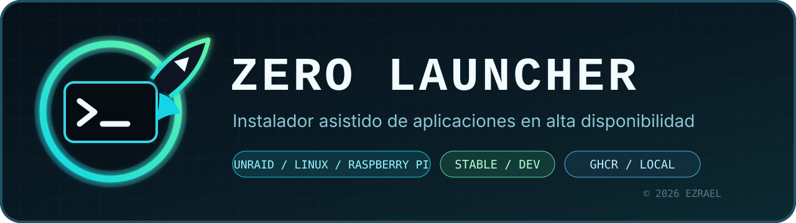

<p align="center">
  
</p>

<p align="center">
  
  
  <a href="LICENSE"></a>
</p>

Zero Launcher es un asistente de terminal para instalar y comprobar aplicaciones Docker
en servidores Linux. Funciona en sistemas `amd64` y `arm64`, incluidos Debian, Ubuntu,
Raspberry Pi OS de 64 bits y Unraid.

Cada aplicación se instala como un único contenedor.

## Aplicaciones disponibles

| Aplicación | Función |
|---|---|
| **Local Registry** | Registro privado de imágenes OCI |
| **Keepalived** | Direcciones flotantes y alta disponibilidad |
| **NPM Guardian** | Réplica de Nginx Proxy Manager |
| **Vault Guardian** | Gestión y réplica de Vaultwarden |
| **RTFM** | Documentación técnica y procedimientos |

## Instalación

Descarga el script y comprueba su integridad:

```bash
curl -fL \
  https://github.com/Ezr43l/zero-launcher-s/releases/latest/download/zero-launcher.sh \
  -o /tmp/zero-launcher.sh

curl -fL \
  https://github.com/Ezr43l/zero-launcher-s/releases/latest/download/zero-launcher.sh.sha256 \
  -o /tmp/zero-launcher.sh.sha256

cd /tmp
sha256sum --check zero-launcher.sh.sha256
chmod +x zero-launcher.sh
sudo ./zero-launcher.sh
```

Para recorrer el asistente sin instalar ni modificar nada:

```bash
./zero-launcher.sh --dry-run
```

## Recorrido

```text
ZERO LAUNCHER
│
├── Instalar aplicaciones
├── Simular una instalación nueva
├── Comprobar instalaciones
├── Acerca de Zero Launcher
└── Salir y guardar el registro
```

Durante una instalación:

1. detecta el sistema y Docker;
2. permite elegir imágenes públicas o un Local Registry;
3. muestra una lista para seleccionar una, varias o todas las aplicaciones;
4. solicita únicamente puertos, rutas y montajes necesarios;
5. presenta el plan completo antes de cambiar nada;
6. instala y comprueba cada contenedor;
7. vuelve al menú principal.

Las cuentas, nodos, credenciales, sincronización y políticas se configuran después desde
la interfaz web de cada aplicación.

## Canales

- `stable`: última publicación estable.
- `dev`: cambios en desarrollo que podrían no ser estables.

Zero Launcher no utiliza la etiqueta `latest`. Cuando sólo existe un canal compatible,
lo selecciona automáticamente.

## Origen de las imágenes

Puedes utilizar directamente las imágenes públicas o copiarlas primero en tu propio
Local Registry. Si eliges el registro local, Zero Launcher lo detecta y reutiliza; si no
existe, lo instala antes de continuar.

No necesitas una cuenta de GitHub ni un servidor Gitea para utilizar las imágenes públicas.

## Compatibilidad

| Sistema | Método |
|---|---|
| Debian y Ubuntu de 64 bits | Docker Compose |
| Raspberry Pi OS de 64 bits | Docker Compose |
| Otros Linux de 64 bits con Docker Engine | Docker Compose |
| Unraid | Plantillas XML y DockerMan |

Raspberry Pi requiere un modelo con procesador de 64 bits y un sistema operativo de
64 bits. En otros Linux deben estar disponibles Docker Engine y el complemento
`docker compose`.

Si falta Docker en una distribución compatible, el asistente muestra lo que necesita y
solicita confirmación antes de instalar paquetes. No elimina paquetes incompatibles ni
reinicia un motor Docker que ya esté funcionando.

## Rutas propuestas

| Elemento | Linux |
|---|---|
| Datos persistentes | `/srv/appdata/<aplicación>` |
| Archivos Compose | `/opt/zero-launcher/<aplicación>/compose.yaml` |
| Registro de la sesión | `/var/log/zero-launcher` |

Las rutas pueden cambiarse durante el asistente. Una carpeta existente se conserva; una
carpeta nueva se crea con los permisos requeridos por la aplicación.

## Instalaciones existentes

Antes de actuar, Zero Launcher distingue entre una aplicación ausente, arrancada,
detenida o averiada. No elimina un contenedor por estar detenido, no crea duplicados y no
cambia el origen de una instalación existente.

Si debe reemplazar un archivo Compose o una plantilla, conserva una copia anterior.
El resumen final permite cancelar antes de realizar cambios.

## Particularidades de las aplicaciones

- Keepalived necesita acceso a la red real del servidor y permisos de red.
- NPM Guardian necesita las rutas reales de datos y certificados de Nginx Proxy Manager.
- Vault Guardian necesita el socket Docker y la raíz de datos de Vaultwarden.
- RTFM necesita que una carpeta nueva permita escritura al usuario `10001:10001`.

## Seguridad

Revisa el script y su suma SHA-256 antes de ejecutarlo como administrador.

Zero Launcher:

- no solicita credenciales de GitHub o Gitea;
- no guarda los secretos funcionales de las aplicaciones;
- no escribe directamente en sus bases de datos;
- no elimina contenedores, volúmenes ni versiones anteriores;
- retira sus archivos temporales al terminar;
- guarda un registro de la sesión en la ruta elegida.

## Soporte

El soporte se presta en la comunidad de Discord de Unraides:

https://discord.gg/8MAT6ZGJTW

Al solicitar ayuda, indica el sistema, las aplicaciones elegidas y el mensaje de error.
No compartas contraseñas, tokens ni archivos privados.

## Licencia

[Apache License 2.0](LICENSE).

Copyright © 2026 Ezrael.

Unraid es una marca de Lime Technology, Inc. Este proyecto es comunitario y no está
afiliado, patrocinado ni respaldado oficialmente por Lime Technology.

